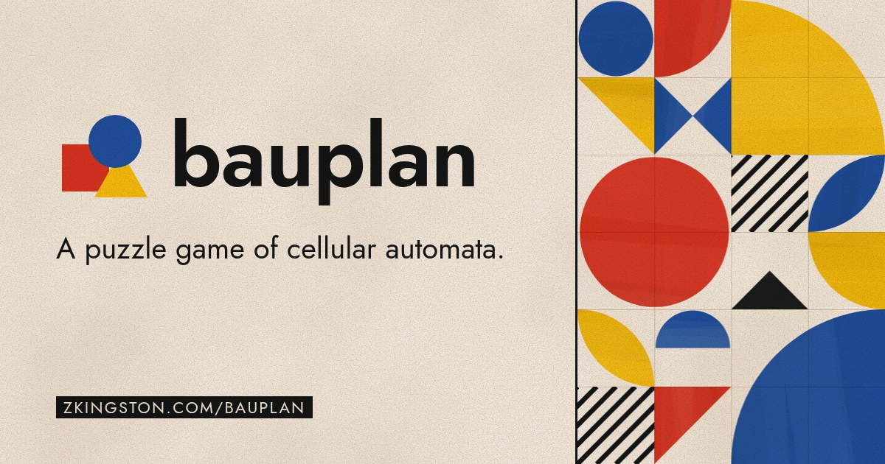

# bauplan



A puzzle game of cellular automata. You write rules, each a 3×3 picture of a piece and its
neighbors, that turn a start board into a target board. Unlimited mode runs your rules on an
infinite board.

Play: https://zkingston.com/bauplan/

Credit to Claude Code for much of the code. This game was heavily inspired by another cellular automata puzzle game, [X’BPGH: The Forbidden Path, a game in Last Call BBS by Zachtronics](https://www.zachtronics.com/last-call-bbs/), which I highly recommend (along with the rest of the Zachtronics/Coincidence catalogue), and the [Bauhaus](https://en.wikipedia.org/wiki/Bauhaus), which helped define the aesthetics.

## Run locally

Running locally needs Node 26.

```sh
npm install
npm run dev    # http://localhost:5173
```

The dev server opens all levels and keeps the level solutions.

| Command             | What it does                                                              |
| ------------------- | ------------------------------------------------------------------------- |
| `npm run dev`       | Vite dev server                                                           |
| `npm run build`     | Production build: one HTML file, in `web/dist`                            |
| `npm test`          | Engine and level tests                                                    |
| `npm run e2e`       | Build, then browser tests in headless Chrome (set `CHROME=` if not found) |
| `npm run typecheck` | `tsc` on the engine, the web app, and the tests                           |
| `npm run lint`      | Prettier check (`npm run format` to fix)                                  |

## Layout

```
engine/                 Rules engine
  src/tile.ts           Tile values: pieces, empty, obstacle, edge
  src/profile.ts        Shapes, colors, and directions
  src/rules.ts          Rule parsing and validation
  src/sim.ts            Board steps, runs to the target, and rule explanations
  src/plane.ts          HashLife implementation for Unlimited mode
  src/puzzle.ts         Puzzle JSON format and validation
  src/share.ts          Share links (deflate + base64url)
  test/                 Tests, including random cases
web/
  index.html
  src/main.ts           Header, nav, and hash routes
  src/screens/          Level track, Play, editor, Custom, Unlimited (worker + view)
  src/components/       Board, palette, rule strip, confirm button, importer
  src/dialogs/          Tutorial, About, and Settings
  src/lib/              DOM helpers, icons, messages, local storage
  src/styles/           CSS, imported in cascade order
  src/data/             levels.json (the level order), puzzles/*.json, and unlimited/*.json
  public/               Icons, web manifest, service worker, link preview image
  e2e/                  Browser tests
  scripts/              Font subsetting and the link preview card
solver/                 GPU search for solutions (see solver/README.md)
.github/workflows/ci.yml
```

## Adding a level

1. Add `web/src/data/puzzles/<name>.json`, with a `hint` and a `solution`.
2. Add `<name>` to `web/src/data/levels.json` at its place in the order.
3. Run `npm test`. It checks that every puzzle file is valid, has a hint, and has a solution that
   wins.

The production build removes the solutions.

## Adding an Unlimited example

1. Add `web/src/data/unlimited/<name>.json`: a `title`, an `about` line, the `rules`, the `start`
   board as rows of tokens with its top left tile at (`x`, `y`), and the `view` box
   `[x0, y0, x1, y1]` that it opens on.
2. Add it to the list in `web/src/data/unlimited.ts`. The ? button of Unlimited lists it.

## Genetic Algorithm Solver

There is also a CUDA implementation of a genetic algorithm to automatically solve puzzles in the `solver/` folder.
